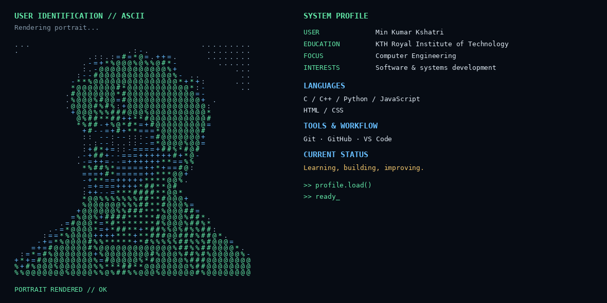

# Hi, I'm Rohan 👋

I’m a developer who enjoys building games, web applications, and small programs while learning by creating real projects.

  

  

## What I work with

  
  
  
  
  
  

## Featured projects

| Project | Description | Tech |
| --- | --- | --- |
| [🎮 Multiplayer Game](https://github.com/RohanRM05/year2-multiplayer-game) | A multiplayer Unity game where players control avatars and join the same online session in real time. | C# · Unity |
| [🧩 3D Maze Game](https://github.com/RohanRM05/gymnasiet-year1-final) | A 3D maze adventure where the player navigates levels, avoids enemies, and fights to reach the finish. | C# · Unity |
| [💬 Chat App](https://github.com/RohanRM05/chatapp) | A web-based chat application project. | JavaScript · CSS |

## More projects

- [Till-mpad_project](https://github.com/RohanRM05/Till-mpad_project) — an additional project from my studies.
- [Cprograms](https://github.com/RohanRM05/Cprograms) — a collection of C programming exercises and experiments.

## Currently building my skills in

- Game development and multiplayer systems
- Web development and user interfaces
- C and C# programming fundamentals
- Turning school projects into clean, maintainable software

---

  Thanks for visiting my profile! Feel free to explore my repositories.

